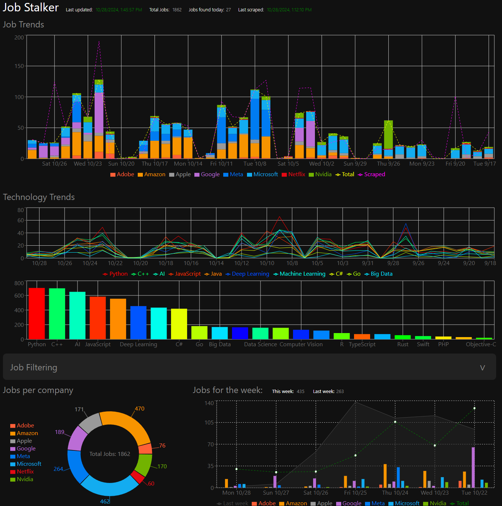
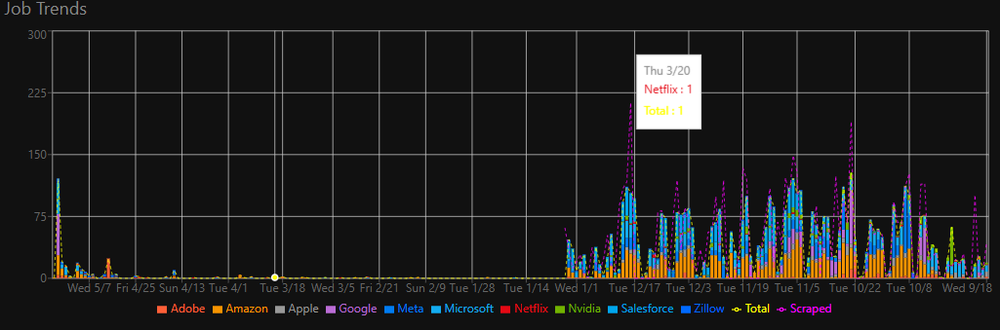
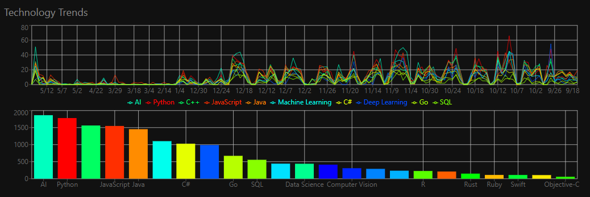
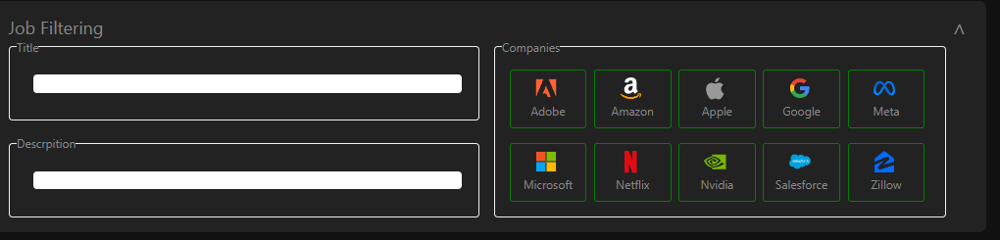
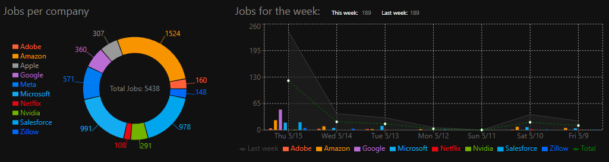
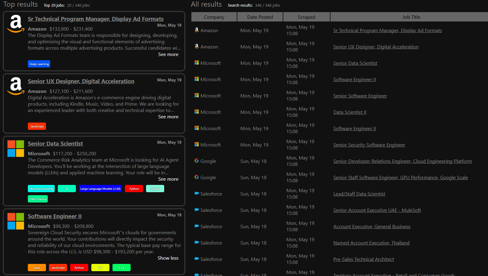
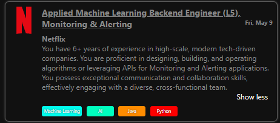

# Job Stalker
Project for monitoring and searching through job listings, parsing job listings, agregating job information such as technology requirements.



## Features

### Job Trends
A graph showing a daily breakdown of jobs posted.


### Tech Trends
A graph showing top level technologies posted for each day and an overall bar chart showing how often a paticular technology is referenced in job postings.


### Search and Filtering
Tools to search through job postings. Fields for searching title, description or filter by any number of companies. Search fields include exclusion of keywords when prefixed with the exclamation mark(`!`).
```
manager !program
```


### Company Share and Weekly Overview
A pie chart shows the percentages of jobs for the filtered search or all jobs if none. The weekly job postings will reflect the search results as well.


### Job Results List
A list of the filtered job listings or all if no search filters.



Each job card gives info:
- Job title
- Link to job post
- Date posted
- Pay range
- Summarization of the job description
- Tags of technical requirements



### Job listing scrapers
Use the settings button to open the Admin Panel. Configure scraper keywords,
the maximum new jobs per company, company selection, and schedules there.
Schedules support intervals, clock times, and weekday restrictions, with an
explicit timezone. They are paused until enabled. Interval schedules wait at
least 30 minutes after worker startup; subsequent intervals can be shorter.
Use **Scrape now** for an immediate manual run using saved settings.

Scraper administration is available only through `localhost` on the computer
running the backend. Both the API and scraper worker must be running; `start.bat`
starts both. Keywords in `config.ini` are no longer used.

## Setup

### Prerequisites
You will need a couple things installed before you start.

- Python: https://www.python.org/downloads/
- Node: https://nodejs.org/en/download

### Application setup and start
To setup and start the application, run the `start.bat` file. This will create a python virtual environment, install required libraries, set up database tables and start services. If you need to restart the app you can just rerun start.bat.
